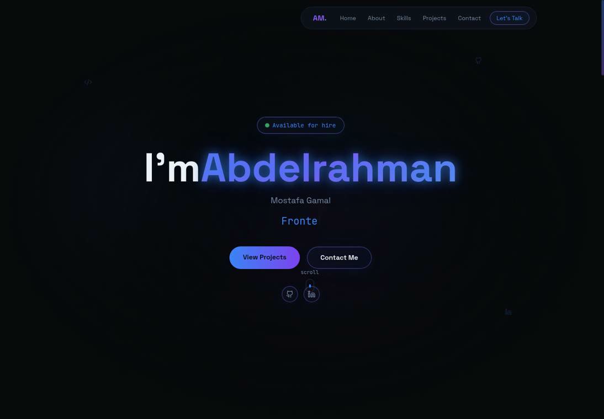

# Abdelrahman Mostafa | Portfolio

   [](LICENSE)

My personal portfolio website, at **https://3bdomos2afa.github.io**

> Deployment is temporarily unavailable. You can run the project locally with the steps below.

## Preview



## Tech stack

- React + TypeScript
- Vite
- Tailwind CSS + shadcn/ui
- Deployed with GitHub Pages

## Run locally

```bash
npm install
npm run dev
```

## Build check

```bash
npm ci --ignore-scripts
npm run build
```

A GitHub Actions build workflow is included. The production build was checked locally with Node.js 22.
